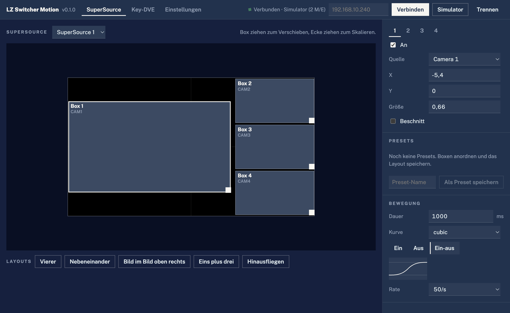

# LZ Switcher Motion

**SuperSource layouts and key DVE moves with easing curves for ATEM switchers.**
Drag the boxes on a picture of the programme frame, save layouts as presets and recall them as smooth moves — ease-in, ease-out, back, elastic and more — instead of the switcher's linear "run to". macOS, Windows and Linux.



## What it does

- **SuperSource editor** — all four boxes on a 16:9 frame with a margin around it, so boxes parked off-screen stay reachable. Drag to move, drag the corner to resize (the top-left corner stays put), arrow keys nudge (Shift = bigger steps). Snaps to a 0.25 grid; hold Alt to move freely. Source, on/off, position, size and crop per box in the side panel. Every change goes to the switcher live. Several SuperSources (2 M/E and up) are selectable.
- **Key DVE** — the same for the DVE of every upstream keyer: position, size (aspect kept when dragging), rotation.
- **Layouts** — quad, side by side (cropped to full height), picture-in-picture, one plus three, fly out. A layout sets geometry only and keeps each box's source.
- **Presets** — save the current layout under a name, recall it as a move. Shift-click recalls as a hard cut. *Save* on a preset overwrites it with the current state.
- **Moves with easing** — eleven curve families (linear, sine, quad, cubic, quart, quint, expo, circ, back, elastic, bounce), each as in, out or in-out, with a small graph of the curve. Duration and update rate (25, 30, 50 or 60 updates per second) are adjustable. The move runs in the app, frame by frame: a box that switches on is visible from the first frame, a box that switches off disappears on the last. A second recall during a move continues from the current position instead of jumping.
- **HTTP control** for Bitfocus Companion (Generic HTTP) or scripts, off by default, listens on 127.0.0.1 only (Settings):
  ```
  GET /recall?preset=Quad&ssrc=0&duration=800&easing=cubic-inOut
  GET /recall?preset=Corner&me=0&keyer=0&easing=back-out
  GET /presets
  ```
  `preset` takes the name (case-insensitive) or the id. `duration` in ms, `rate` in updates per second, `easing` as `family-direction`; without them the move settings from the app apply.
- **Simulator** — a 2 M/E-sized switcher without hardware, to try layouts and presets.
- English and German interface.

## Units

The fields show the values of the switcher's own control software. The picture spans X −16…16 and Y −9…9 (Y up). SuperSource: X −48…48, Y −27…27, size 0.07…1, crop top/bottom 0…18, left/right 0…32. DVE: position in the same frame units, size 1 = full frame.

## Status

Built on [atem-connection](https://github.com/Sofie-Automation/sofie-atem-connection) (MIT). **Tested only against the built-in simulator so far, not on a real switcher.** Open points for the first hardware test:

- how smoothly the switcher follows 50 updates per second over the network (lower the rate if moves stutter)
- DVE rotation units (sent as tenths of a degree)
- SuperSource on models with per-box borders (Constellation HD and newer) — borders are not touched

## Install

Download from [Releases](https://github.com/larszu/lz-switcher-motion/releases): `.dmg` (macOS, universal), `.exe` installer or portable (Windows), `.AppImage` or `.deb` (Linux). Builds are unsigned: on macOS right-click → *Open* on first start; on Windows *More info → Run anyway*.

The computer needs to reach the switcher on UDP port 9910.

## Develop

```bash
npm install
npm run dev        # Vite on 4193 + Electron
npm run check      # typecheck + tests
npm run dist:mac   # or dist:win / dist:linux
```

Presets and settings live in `lz-switcher-motion.json` in the app's user data folder.

## Licence

MIT. Not affiliated with Blackmagic Design; ATEM is a trademark of Blackmagic Design.
